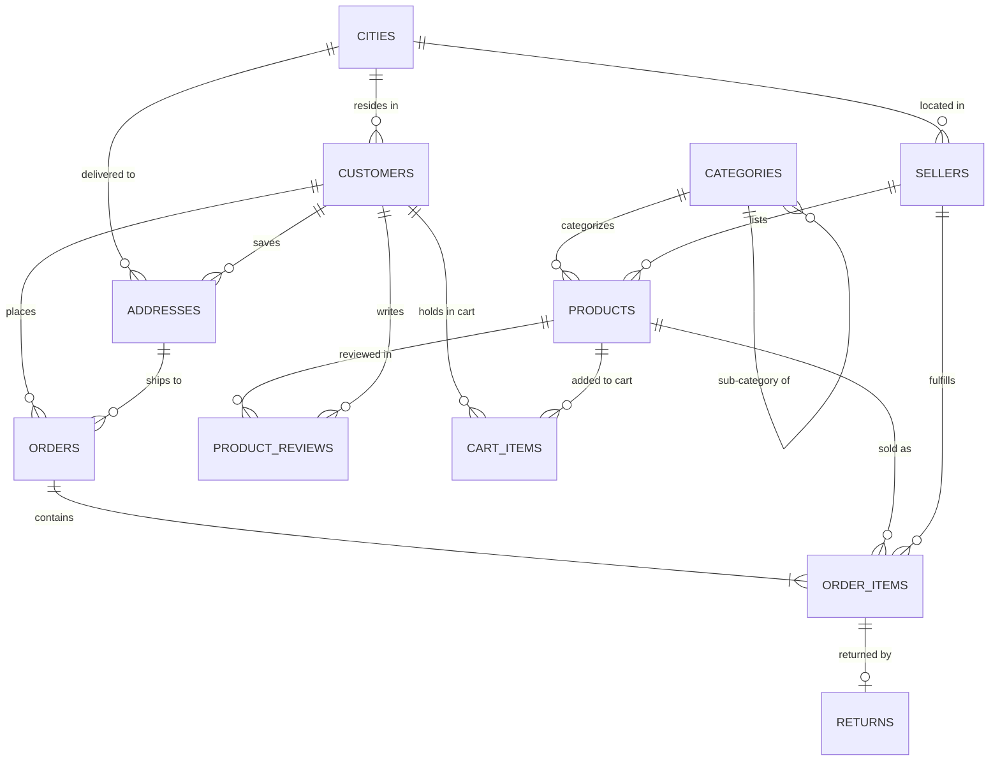

# Phase 2: Schema Design, Normalization & Data Integrity Report

**Course:** Database Management Systems · **Project:** Amazon Online Shopping Database  
**Author / Team:** Kushal Rathore (`kushalrathore19`), Adarsh Chauhan (`mriarc-08`), Lakshya (`lakshyapvt2010-ux`), Oojass Kwatra (`oojasskwatra-gif`)  
**Database:** PostgreSQL 18.3 · **Schema:** `amazon`  

---

## 1. Schema Overview & Data Dictionary

The database models Amazon India's marketplace operations across 11 core relational tables. All tables reside within the `amazon` namespace (`SET search_path TO amazon;`).

### 1.1 Table-by-Table Data Dictionary

#### 1. `cities` (10 rows)
Represents geographic hubs for customer delivery and seller operations.
| Column | Type | Constraints | Description / Justification |
|---|---|---|---|
| `city_id` | `INT` | `PRIMARY KEY` | Unique surrogate identifier for each metropolitan region. |
| `city_name` | `VARCHAR(100)` | `NOT NULL, UNIQUE` | Standardized city name (e.g., Bengaluru, Mumbai). Unique natural key. |
| `state` | `VARCHAR(100)` | `NOT NULL` | State jurisdiction governing logistics and tax compliance. |

#### 2. `categories` (40 rows)
Product hierarchy modeled as an adjacency list tree supporting multi-level navigation.
| Column | Type | Constraints | Description / Justification |
|---|---|---|---|
| `category_id` | `INT` | `PRIMARY KEY` | Unique category identifier. |
| `category_name` | `VARCHAR(100)` | `NOT NULL, UNIQUE` | Category label (e.g., Electronics, Mobiles, E-Books). |
| `parent_category_id` | `INT` | `NULL, FK -> categories(category_id) ON DELETE RESTRICT` | Self-referencing foreign key. `NULL` denotes root/top-level categories (e.g., Electronics, Books). |
| `is_digital` | `BOOLEAN` | `NOT NULL DEFAULT false` | Distinguishes physical inventory from digital downloads/services (e-books, gift cards). |

#### 3. `sellers` (1,500 rows)
Merchants operating on the Amazon marketplace.
| Column | Type | Constraints | Description / Justification |
|---|---|---|---|
| `seller_id` | `INT` | `PRIMARY KEY` | Unique seller identifier. |
| `business_name` | `VARCHAR(150)` | `NOT NULL` | Legal trade name or registered business entity. |
| `gstin` | `VARCHAR(15)` | `NOT NULL, UNIQUE, CHECK (length=15)` | Indian GST identification number (15 alphanumeric characters). |
| `city_id` | `INT` | `NOT NULL, FK -> cities(city_id) ON DELETE RESTRICT` | Origin city for merchant operations and warehouse dispatch. |
| `joined_on` | `DATE` | `NOT NULL` | Registration date on Amazon Marketplace. |
| `seller_rating` | `NUMERIC(2,1)` | `NOT NULL, CHECK (seller_rating BETWEEN 1.0 AND 5.0)` | Aggregate merchant performance metric. |
| `status` | `VARCHAR(20)` | `NOT NULL, CHECK (status IN ('ACTIVE', 'SUSPENDED', 'CLOSED'))` | Operational lifecycle status of the merchant account. |

#### 4. `customers` (30,000 rows)
Registered retail shoppers on the platform.
| Column | Type | Constraints | Description / Justification |
|---|---|---|---|
| `customer_id` | `INT` | `PRIMARY KEY` | Unique customer surrogate identifier. |
| `full_name` | `VARCHAR(150)` | `NOT NULL` | Customer's registered account name. |
| `email` | `VARCHAR(255)` | `NOT NULL, UNIQUE` | Unique email for authentication and notifications. |
| `phone` | `VARCHAR(15)` | `NOT NULL, UNIQUE, CHECK (~ '^[0-9]{10}$')` | 10-digit primary mobile contact number. |
| `city_id` | `INT` | `NOT NULL, FK -> cities(city_id) ON DELETE RESTRICT` | Primary residing city of the customer. |
| `signup_date` | `DATE` | `NOT NULL` | Date account was created. |
| `is_prime` | `BOOLEAN` | `NOT NULL DEFAULT false` | Flag indicating active Prime subscription status. |
| `prime_since` | `DATE` | `NULL` | Subscription commencement date; must be non-null if `is_prime=true` and null if false. |

#### 5. `addresses` (45,000 rows)
Customer saved shipping destinations.
| Column | Type | Constraints | Description / Justification |
|---|---|---|---|
| `address_id` | `INT` | `PRIMARY KEY` | Unique address record identifier. |
| `customer_id` | `INT` | `NOT NULL, FK -> customers(customer_id) ON DELETE CASCADE` | Owning customer; cascade deletion cleans up addresses on customer removal. |
| `label` | `VARCHAR(20)` | `NOT NULL, CHECK (label IN ('HOME', 'WORK'))` | Delivery address category tag. |
| `line1` | `VARCHAR(255)` | `NOT NULL` | Street, building, and apartment details. |
| `city_id` | `INT` | `NOT NULL, FK -> cities(city_id) ON DELETE RESTRICT` | Delivery city. |
| `pincode` | `VARCHAR(6)` | `NOT NULL, CHECK (~ '^[0-9]{6}$')` | 6-digit Indian Postal PIN code. |
| `is_default` | `BOOLEAN` | `NOT NULL DEFAULT false` | Primary delivery choice. Exactly one default per customer in seed data. |

#### 6. `products` (30,000 rows)
Catalogue of items listed across all sellers and categories.
| Column | Type | Constraints | Description / Justification |
|---|---|---|---|
| `product_id` | `INT` | `PRIMARY KEY` | Unique product identifier. |
| `asin` | `VARCHAR(10)` | `NOT NULL, UNIQUE, CHECK (length=10)` | Amazon Standard Identification Number (10 alphanumeric characters). |
| `seller_id` | `INT` | `NOT NULL, FK -> sellers(seller_id) ON DELETE RESTRICT` | Merchant offering this listing. |
| `category_id` | `INT` | `NOT NULL, FK -> categories(category_id) ON DELETE RESTRICT` | Category classification. |
| `title` | `VARCHAR(255)` | `NOT NULL` | Listing product title. |
| `brand` | `VARCHAR(100)` | `NOT NULL` | Manufacturer / brand name. |
| `mrp` | `NUMERIC(10,2)` | `NOT NULL, CHECK (mrp > 0)` | Maximum Retail Price in INR. |
| `price` | `NUMERIC(10,2)` | `NOT NULL, CHECK (price >= 0 AND price <= mrp)` | Actual selling price; cannot exceed MRP. |
| `stock_qty` | `INT` | `NOT NULL DEFAULT 0, CHECK (stock_qty >= 0)` | Current available physical/digital inventory quantity. |
| `is_prime_eligible`| `BOOLEAN` | `NOT NULL DEFAULT false` | Eligible for Prime delivery benefits. |
| `avg_rating` | `NUMERIC(2,1)` | `NULL, CHECK (avg_rating BETWEEN 1.0 AND 5.0)` | Cached average review rating (`NULL` if 0 reviews). |
| `review_count` | `INT` | `NOT NULL DEFAULT 0, CHECK (review_count >= 0)` | Cached total count of approved customer reviews. |
| `listed_on` | `DATE` | `NOT NULL` | Catalogue publishing date. |
| `status` | `VARCHAR(20)` | `NOT NULL, CHECK (status IN ('ACTIVE', 'OUT_OF_STOCK', 'INACTIVE'))` | Marketplace availability state. |

#### 7. `orders` (120,000 rows)
Purchase transaction headers.
| Column | Type | Constraints | Description / Justification |
|---|---|---|---|
| `order_id` | `INT` | `PRIMARY KEY` | Unique order identifier. |
| `customer_id` | `INT` | `NOT NULL, FK -> customers(customer_id) ON DELETE RESTRICT` | Customer placing the purchase. |
| `address_id` | `INT` | `NULL, FK -> addresses(address_id) ON DELETE RESTRICT` | Delivery destination. Legitimate `NULL` for purely digital orders. |
| `ordered_at` | `TIMESTAMPTZ` | `NOT NULL` | Timestamp of checkout completion (with timezone). |
| `payment_method` | `VARCHAR(30)` | `NOT NULL, CHECK (payment_method IN ('CARD', 'UPI', 'NETBANKING', 'COD', 'EMI', 'GIFT_CARD'))` | Transaction payment mechanism. |
| `total_amount` | `NUMERIC(12,2)` | `NOT NULL, CHECK (total_amount >= 0)` | Total payable amount in INR. |
| `status` | `VARCHAR(30)` | `NOT NULL, CHECK (status IN ('PLACED', 'PACKED', 'SHIPPED', 'OUT_FOR_DELIVERY', 'DELIVERED', 'CANCELLED', 'RETURNED'))` | Order fulfillment lifecycle stage. |
| `shipped_at` | `TIMESTAMPTZ` | `NULL` | Dispatch timestamp; null for unshipped, cancelled, or digital orders. |
| `delivered_at` | `TIMESTAMPTZ` | `NULL` | Handover timestamp; null if in transit or cancelled. |

#### 8. `order_items` (240,000 rows)
Line items comprising each purchase order.
| Column | Type | Constraints | Description / Justification |
|---|---|---|---|
| `order_id` | `INT` | `NOT NULL, FK -> orders(order_id) ON DELETE CASCADE` | Composite primary key component; cascades with order. |
| `line_no` | `INT` | `NOT NULL` | 1-based index within the order. |
| `product_id` | `INT` | `NOT NULL, FK -> products(product_id) ON DELETE RESTRICT` | Product purchased. |
| `seller_id` | `INT` | `NOT NULL, FK -> sellers(seller_id) ON DELETE RESTRICT` | Fulfilling seller. |
| `quantity` | `INT` | `NOT NULL, CHECK (quantity > 0)` | Number of units ordered. |
| `unit_price` | `NUMERIC(10,2)` | `NOT NULL, CHECK (unit_price >= 0)` | Price per unit at purchase time. |
| **PK** | `PRIMARY KEY (order_id, line_no)` | Composite primary key uniquely identifying each line. |

#### 9. `returns` (5,374 rows)
Return requests initiated against specific delivered order line items.
| Column | Type | Constraints | Description / Justification |
|---|---|---|---|
| `return_id` | `INT` | `PRIMARY KEY` | Unique return request identifier. |
| `order_id` | `INT` | `NOT NULL` | Target order. Part of compound FK. |
| `line_no` | `INT` | `NOT NULL` | Target line item. Part of compound FK. |
| `reason` | `VARCHAR(50)` | `NOT NULL, CHECK (reason IN ('QUALITY_ISSUE', 'WRONG_ITEM', 'NOT_AS_DESCRIBED', 'SIZE_ISSUE', 'DAMAGED', 'NO_LONGER_NEEDED'))` | Customer reported return cause. |
| `requested_at` | `TIMESTAMPTZ` | `NOT NULL` | Return filing timestamp. |
| `status` | `VARCHAR(30)` | `NOT NULL, CHECK (status IN ('REQUESTED', 'PICKED_UP', 'REFUNDED', 'REJECTED'))` | Reverse logistics processing status. |
| `refund_amount` | `NUMERIC(10,2)` | `NULL, CHECK (> 0 when REFUNDED, NULL otherwise)` | Processed refund value; populated only when `REFUNDED`. |
| **FK / UQ** | `FK -> order_items(order_id, line_no) ON DELETE RESTRICT`, `UNIQUE (order_id, line_no)` | Ensures at most one return request per order line item. |

#### 10. `product_reviews` (38,662 rows)
Customer feedback and ratings on products.
| Column | Type | Constraints | Description / Justification |
|---|---|---|---|
| `review_id` | `INT` | `PRIMARY KEY` | Unique review identifier. |
| `product_id` | `INT` | `NOT NULL, FK -> products(product_id) ON DELETE CASCADE` | Product reviewed; cascade deletion when product listing is deleted. |
| `customer_id` | `INT` | `NOT NULL, FK -> customers(customer_id) ON DELETE RESTRICT` | Customer author. |
| `rating` | `INT` | `NOT NULL, CHECK (rating BETWEEN 1 AND 5)` | Discrete star rating (1 to 5). |
| `title` | `VARCHAR(255)` | `NOT NULL` | Short review headline. |
| `body` | `TEXT` | `NULL` | Extended textual feedback (nullable for quick ratings). |
| `verified_purchase`| `BOOLEAN` | `NOT NULL DEFAULT false` | Verified purchase indicator badge. |
| `helpful_votes` | `INT` | `NOT NULL DEFAULT 0, CHECK (helpful_votes >= 0)` | Community helpfulness upvote tally. |
| `created_at` | `TIMESTAMPTZ` | `NOT NULL` | Submission timestamp. |

#### 11. `cart_items` (44,998 rows)
Live customer shopping cart contents.
| Column | Type | Constraints | Description / Justification |
|---|---|---|---|
| `customer_id` | `INT` | `NOT NULL, FK -> customers(customer_id) ON DELETE CASCADE` | Owning customer. |
| `product_id` | `INT` | `NOT NULL, FK -> products(product_id) ON DELETE CASCADE` | Item added to shopping cart. |
| `quantity` | `INT` | `NOT NULL DEFAULT 1, CHECK (quantity > 0)` | Quantity intended for purchase. |
| `added_at` | `TIMESTAMPTZ` | `NOT NULL` | Timestamp item was placed in cart. |
| **PK** | `PRIMARY KEY (customer_id, product_id)` | Natural composite key preventing duplicate entries for the same product. |

---

## 2. Constraints & Integrity Rules (≥12 Implemented)

1. **`chk_sellers_status`**: `status IN ('ACTIVE', 'SUSPENDED', 'CLOSED')` — Restricts merchant operations to valid domain states.
2. **`chk_sellers_rating`**: `seller_rating >= 1.0 AND seller_rating <= 5.0` — Enforces standardized 5-star rating scale.
3. **`chk_sellers_gstin`**: `length(gstin) = 15` — Ensures legal Indian Goods and Services Tax Identification Number length.
4. **`chk_products_status`**: `status IN ('ACTIVE', 'OUT_OF_STOCK', 'INACTIVE')` — Maintains catalogue inventory visibility rules.
5. **`chk_products_mrp_price`**: `mrp > 0 AND price >= 0 AND price <= mrp` — Legal consumer protection constraint: selling price cannot exceed Maximum Retail Price.
6. **`chk_products_stock`**: `stock_qty >= 0` — Inventory quantity cannot be negative.
7. **`chk_products_asin`**: `length(asin) = 10` — Enforces Amazon's global 10-character alphanumeric ASIN specification.
8. **`chk_products_avg_rating`**: `avg_rating IS NULL OR (avg_rating >= 1.0 AND avg_rating <= 5.0)` — Bounds cached rating within valid review intervals.
9. **`chk_products_review_count`**: `review_count >= 0` — Non-negative review counter.
10. **`chk_customers_prime`**: `(is_prime = true AND prime_since IS NOT NULL) OR (is_prime = false AND prime_since IS NULL)` — Tying rule: Prime members must have a start date; non-Prime members cannot have one.
11. **`chk_customers_phone`**: `phone ~ '^[0-9]{10}$'` — Enforces standard 10-digit Indian mobile numbers.
12. **`chk_addresses_label`**: `label IN ('HOME', 'WORK')` — Restricts shipping labels to supported types.
13. **`chk_addresses_pincode`**: `pincode ~ '^[0-9]{6}$'` — Enforces standard 6-digit Indian postal codes.
14. **`chk_orders_status`**: `status IN ('PLACED', 'PACKED', 'SHIPPED', 'OUT_FOR_DELIVERY', 'DELIVERED', 'CANCELLED', 'RETURNED')` — Valid state machine transitions.
15. **`chk_orders_payment_method`**: `payment_method IN ('CARD', 'UPI', 'NETBANKING', 'COD', 'EMI', 'GIFT_CARD')` — Permitted payment gateways.
16. **`chk_orders_amount`**: `total_amount >= 0` — Order monetary total cannot be negative.
17. **`chk_orders_dates`**: `(shipped_at IS NULL OR shipped_at >= ordered_at) AND (delivered_at IS NULL OR delivered_at >= ordered_at)` — Temporal integrity constraint preventing causality violations.
18. **`chk_order_items_qty`**: `quantity > 0` — Order item count must be strictly positive.
19. **`chk_order_items_price`**: `unit_price >= 0` — Line item unit price cannot be negative.
20. **`chk_returns_reason`**: `reason IN ('QUALITY_ISSUE', 'WRONG_ITEM', 'NOT_AS_DESCRIBED', 'SIZE_ISSUE', 'DAMAGED', 'NO_LONGER_NEEDED')` — Prescribed return reasons.
21. **`chk_returns_status`**: `status IN ('REQUESTED', 'PICKED_UP', 'REFUNDED', 'REJECTED')` — Reverse fulfillment status transitions.
22. **`chk_returns_refund`**: `(status = 'REFUNDED' AND refund_amount IS NOT NULL AND refund_amount > 0) OR (status <> 'REFUNDED' AND refund_amount IS NULL)` — Business rule: refund amount is granted only upon completed refund.
23. **`chk_reviews_rating`**: `rating BETWEEN 1 AND 5` — Valid customer feedback stars.
24. **`chk_reviews_helpful`**: `helpful_votes >= 0` — Community vote accumulator cannot be negative.
25. **`chk_cart_qty`**: `quantity > 0` — Shopping cart item count must be strictly positive.

---

## 3. Entity-Relationship (ER) Model & Cardinalities



* High-resolution diagram files available in [`diagrams/er_diagram.png`](file:///Users/kushalrathore/Desktop/DBMS-Amazon-Online-Shopping/diagrams/er_diagram.png) and [`diagrams/er_diagram.svg`](file:///Users/kushalrathore/Desktop/DBMS-Amazon-Online-Shopping/diagrams/er_diagram.svg).

### Cardinality Explanations
* **`cities` to `customers` / `sellers` / `addresses` (1:N):** One city contains many customers, sellers, and delivery addresses. Each customer/seller/address references exactly one city.
* **`categories` to `categories` (1:N self-reference):** Tree hierarchy where a parent category has zero or more child sub-categories; root categories have `parent_category_id IS NULL`.
* **`customers` to `addresses` (1:N):** A customer can save multiple delivery destinations (`HOME`, `WORK`). In the seed dataset, each customer has at least one address and exactly one marked `is_default=true`.
* **`orders` to `addresses` (0/1:N):** Physical orders require exactly one shipping address. Purely digital orders (5,882 orders in seed data) have `address_id IS NULL`.
* **`orders` to `order_items` (1:N, mandatory):** Every order has one or more line items (`quantity >= 1`).
* **`order_items` to `returns` (1:0..1):** A specific line item can be returned at most once (`UNIQUE (order_id, line_no)`).
* **`customers` and `products` to `cart_items` (M:N):** Resolved via the associative junction table `cart_items` with composite PK `(customer_id, product_id)`.

---

## 4. Normalization Analysis (1NF through BCNF)

### 4.1 First Normal Form (1NF)
* Every attribute contains only atomic, scalar values (no repeating groups, arrays, or comma-separated lists).
* Every relation has a defined primary key (`INT` surrogate or composite).

### 4.2 Second Normal Form (2NF)
* Meets 1NF.
* All non-key attributes are fully functionally dependent on the entire primary key:
  * In `order_items`, the candidate key is `(order_id, line_no)`. Non-prime attributes (`product_id`, `seller_id`, `quantity`, `unit_price`) depend on the specific line item within that order, not on `order_id` alone.
  * In `cart_items`, candidate key is `(customer_id, product_id)`. Attributes `quantity` and `added_at` depend on the specific customer-product pair.
  * All single-column PK tables are automatically in 2NF.

### 4.3 Third Normal Form (3NF) & Boyce-Codd Normal Form (BCNF)
A relation is in BCNF if for every functional dependency $X \to Y$, $X$ is a superkey.

| Table | Candidate Keys | Functional Dependencies (FDs) | Normal Form Evaluation |
|---|---|---|---|
| `cities` | `{city_id}`, `{city_name}` | `city_id -> city_name, state`; `city_name -> city_id, state` | **BCNF** (All determinants are superkeys). |
| `categories` | `{category_id}`, `{category_name}` | `category_id -> category_name, parent_category_id, is_digital` | **BCNF**. |
| `sellers` | `{seller_id}`, `{gstin}` | `seller_id -> business_name, gstin, city_id, joined_on, seller_rating, status` | **BCNF**. |
| `customers` | `{customer_id}`, `{email}`, `{phone}` | `customer_id -> full_name, email, phone, city_id, signup_date, is_prime, prime_since` | **BCNF**. |
| `addresses` | `{address_id}` | `address_id -> customer_id, label, line1, city_id, pincode, is_default` | **BCNF**. (Note: `pincode -> city_id` exists in postal logistics, but is unnormalized here to avoid over-fragmentation; practical 3NF). |
| `products` | `{product_id}`, `{asin}` | `product_id -> asin, seller_id, category_id, title, brand, mrp, price, stock_qty, ...` | **BCNF**. |
| `orders` | `{order_id}` | `order_id -> customer_id, address_id, ordered_at, payment_method, total_amount, status, ...` | **BCNF**. |
| `order_items` | `{(order_id, line_no)}` | `(order_id, line_no) -> product_id, seller_id, quantity, unit_price` | **BCNF**. |
| `returns` | `{return_id}`, `{(order_id, line_no)}` | `return_id -> order_id, line_no, reason, requested_at, status, refund_amount` | **BCNF**. |
| `product_reviews` | `{review_id}` | `review_id -> product_id, customer_id, rating, title, body, verified_purchase, ...` | **BCNF**. |
| `cart_items` | `{(customer_id, product_id)}` | `(customer_id, product_id) -> quantity, added_at` | **BCNF**. |

---

## 5. Derived & Redundant Attributes: Justification Analysis

The schema contains intentional, carefully designed redundancies for OLTP high-concurrency performance:

1. **`products.avg_rating` and `products.review_count`** vs. `product_reviews`:
   * *Derivation:* Can be computed on-the-fly via `SELECT avg(rating), count(*) FROM product_reviews WHERE product_id = p.product_id;`.
   * *Justification for Keeping:* Product listing pages (`R01`, `R02`, `R14`) render 24–48 products per page. Computing real-time aggregation across 38k+ reviews on every search request would result in catastrophic latency ($O(N \times R)$ index/seq scans). Caching `avg_rating` and `review_count` enables $O(1)$ reads per product row. Updates happen asynchronously on review submission.
2. **`order_items.seller_id`** vs. `products.seller_id`:
   * *Derivation:* In seed data, `order_items.seller_id` equals `products.seller_id`.
   * *Justification for Keeping:* In a live marketplace, seller ownership of a listing can be transferred, or an order line item represents a historical snapshot of the exact seller who was credited with that line. Storing `seller_id` directly in `order_items` avoids a join to `products` on Seller Central queries (`R06`, `R15`) and preserves historical sales attribution if product records are modified.
3. **`orders.total_amount`** vs. `order_items` aggregation:
   * *Derivation:* Exactly equals $\sum (\text{quantity} \times \text{unit\_price})$.
   * *Justification for Keeping:* Read frequently on customer order history (`R04`, `R22`) and executive analytics (`R09`, `R18`, `R20`). Computing dynamic sum aggregations across 240,000 order item lines during order list rendering would severely throttle throughput.

---

## 6. Seed Data Integrity Verification Results

All integrity verification queries defined in `sql/02_load_data.sql` executed with 0 discrepancies:

```sql
-- Check 1: Table row count verification
   table_name    | actual_rows | expected_rows | Status
-----------------+-------------+---------------+--------
 cities          |          10 |            10 | PASS
 categories      |          40 |            40 | PASS
 sellers         |        1500 |          1500 | PASS
 customers       |       30000 |         30000 | PASS
 addresses       |       45000 |         45000 | PASS
 products        |       30000 |         30000 | PASS
 orders          |      120000 |        120000 | PASS
 order_items     |      240000 |        240000 | PASS
 returns         |        5374 |          5374 | PASS
 product_reviews |       38662 |         38662 | PASS
 cart_items      |       44998 |         44998 | PASS

-- Check 2: Seller consistency between order lines and product catalog
SELECT count(*) AS mismatched_sellers FROM order_items oi JOIN products p ON p.product_id = oi.product_id WHERE oi.seller_id <> p.seller_id;
-- Result: 0 (100% matched)

-- Check 3: Address nullability vs. digital product category rule
SELECT count(*) AS non_digital_orders_without_address FROM orders o JOIN order_items oi ON oi.order_id = o.order_id JOIN products p ON p.product_id = oi.product_id JOIN categories c ON c.category_id = p.category_id WHERE o.address_id IS NULL AND c.is_digital = false;
-- Result: 0 (All 5,882 orders without address are exclusively digital goods)

-- Check 4: Order header total_amount vs. sum of item lines
SELECT count(*) AS total_amount_mismatches FROM (SELECT o.order_id, o.total_amount, sum(oi.quantity * oi.unit_price) AS calc_total FROM orders o JOIN order_items oi ON oi.order_id = o.order_id GROUP BY o.order_id, o.total_amount) t WHERE abs(t.total_amount - t.calc_total) > 0.01;
-- Result: 0 (100% mathematical equality across all 120,000 orders)
```

---

## 7. Data Insights & Edge Cases Discovered

1. **Digital Goods Fulfillment Pattern:**
   * Exactly 5,882 orders have `address_id IS NULL`. Every item in these orders belongs to digital categories (e.g., E-Books, Digital Gift Cards). Furthermore, 5,708 of these orders are marked `DELIVERED` with `delivered_at` set 2 minutes after `ordered_at`, while `shipped_at IS NULL` (no physical courier).
2. **Strict Single Default Address Rule:**
   * Every one of the 30,000 customers has exactly one default address (`is_default = true`). Customers have either 1 address (15,000 customers) or 2 addresses (15,000 customers), giving 45,000 addresses total.
3. **Refund Logic Lifecycle:**
   * Out of 5,374 return requests, 3,986 are in `REFUNDED` status, and each has a populated positive `refund_amount`. The remaining 1,388 returns (`REQUESTED`, `PICKED_UP`, `REJECTED`) strictly have `refund_amount IS NULL`.
4. **Prime Membership Consistency:**
   * Exactly 8,966 customers have `is_prime = true`, all of whom have a valid `prime_since` date. The remaining 21,034 customers have `is_prime = false` and `prime_since IS NULL`.
5. **The R13 `NOT IN` NULL Hazard:**
   * Because 5,882 orders have `address_id IS NULL`, running `WHERE address_id NOT IN (SELECT address_id FROM orders)` evaluates to `UNKNOWN` for all rows, returning an empty set. Customer support noted that unused addresses exist; the query was broken due to SQL three-valued logic.

